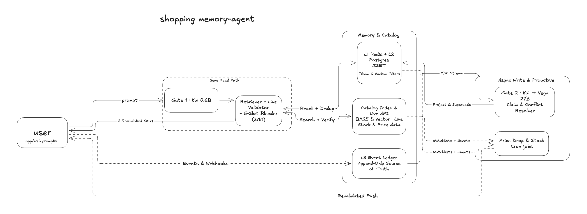

# Shopping Memory Agent

### Overview

## Latency

median latency(p50)
system one decision model: 10ms
read write and dedup latencies: ~16.5ms

### Memory & Decision Layer latency= 26.5ms/query
adding another 600ms for pre-flight(context injected) for LLM + memory layer latency= ~700ms

## Cost

cost per 1M queries: $65
system one decision model cost per query: $0.000012
### Total memory & decision layer cost per query: $0.000065/query
frontier LLM cost: $0.000450

## High Level Architecture Daigram

```mermaid
---
config:
  layout: elk
  elk:
    nodePlacementStrategy: BRANDES_KOEPF
    considerModelOrder: NODES_AND_EDGES
  theme: base
  themeVariables:
    background: "#ffffff"
    fontSize: "15px"
    primaryTextColor: "#0f172a"
    textColor: "#0f172a"
    titleColor: "#0f172a"
    lineColor: "#475569"
    clusterBkg: "#f8fafc"
    clusterBorder: "#cbd5e1"
    edgeLabelBackground: "#ffffff"
  flowchart:
    wrappingWidth: 360
    nodeSpacing: 28
    rankSpacing: 46
---
flowchart TB
    classDef client fill:#f1f5f9,stroke:#64748b,color:#0f172a,stroke-width:1px
    classDef ext fill:#ffffff,stroke:#6b7280,color:#111827,stroke-width:1px,stroke-dasharray:5 3
    classDef router fill:#e0f2fe,stroke:#0284c7,color:#0c4a6e,stroke-width:2px
    classDef guard fill:#ffe4e6,stroke:#e11d48,color:#881337,stroke-width:2px
    classDef l1 fill:#fef3c7,stroke:#d97706,color:#78350f,stroke-width:1.5px
    classDef l2 fill:#d1fae5,stroke:#059669,color:#064e3b,stroke-width:1.5px
    classDef l3 fill:#e0e7ff,stroke:#4f46e5,color:#312e81,stroke-width:1.5px
    classDef worker fill:#f3e8ff,stroke:#9333ea,color:#581c87,stroke-width:1.5px
    classDef pro fill:#ffedd5,stroke:#ea580c,color:#7c2d12,stroke-width:1.5px
    classDef dlq fill:#fee2e2,stroke:#dc2626,color:#7f1d1d,stroke-width:1.5px
    classDef decision fill:#ccfbf1,stroke:#0d9488,color:#134e4a,stroke-width:2px

    subgraph LEG ["Legend"]
        direction LR
        LG1["Deterministic code gate · never an LLM"]:::guard
        LG2["Synchronous read component"]:::router
        LG3["Async worker"]:::worker
        LG4["Proactive / scheduled"]:::pro
        LG5["External system"]:::ext
        LG6["System One decision model · closed answer sets"]:::decision
    end

    subgraph ING ["1 · Ingress"]
        APP["Client App<br/>prompt · cart action · notification deep link<br/>envelope: pincode + device size cache"]:::client
        ORC["Shopping Agent Orchestrator<br/>stamps author + persona on every emitted turn"]:::router
        WHG["Webhook Gateway<br/>HMAC + timestamp check · 2xx only after enqueue<br/>orders · returns · delivery · notification receipts"]:::client
    end

    subgraph READ ["2 · Synchronous Read Path · sub-400 ms p95 pre-flight · one pinned decision read, no generative calls"]
        SSR["L1 Session Summary Read · hop 1 · ~1 ms<br/>HGETALL sess + hc snapshot"]:::router
        subgraph G1 ["Gate 1 · System One POST /v1/systemone · model pinned: Kai 0.6B · no cascade on hot path"]
            RB_R["Request Builder (code)<br/>state = prompt + session summary + client envelope<br/>answer sets from catalog taxonomy + entity matcher"]:::guard
            KAI_R["Decision 2.0 Kai 0.6B · one call, choice questions<br/>#1 Intent · #2 Persona · #3 Category<br/>#4 Polarity per matched entity<br/>include · exclude · neutral · #5 Memory plan"]:::decision
            FB_R["Confidence Fallback (code)<br/>conf below τ · timeout · breaker open<br/>rule route · full L1 + L2 plan<br/>persona chip · lexicon polarity"]:::guard
        end
        HM["Health Monitor + Circuit Breakers<br/>L1 · L2 · /catalog · /v1/systemone → degradation mode"]:::guard
        HR["Hybrid Retriever → 40 SKUs<br/>BM25 + dense · RRF fusion · hard-predicate prefilter<br/>quota 24 relevant · 10 best-seller · 6 explore"]:::router
        MR["Memory Recall (L2)<br/>fit summaries · colour + price band · claims"]:::router
        DG["Dedup Gate (in-memory)<br/>drop BF_seen + CF_rejected hits"]:::guard
        HV["Deterministic Constraint Validator (code)<br/>live: size in stock · pincode · price ceiling<br/>exclusions · NEG spans · persona-scoped sizes"]:::guard
        MMR["Slot Allocator + 5-Slot MMR Blender<br/>normal 3:1:1 · L2 down 1:3:1 · L1+L2 down 0:4:1<br/>exploit (LRFU brands) : best-seller : out-of-box"]:::router
        CC["Context Compiler<br/>pinned constraints · 5 validated SKUs · recalled memory"]:::router
        GEN["Orchestrator LLM turn<br/>reply references SKU ids only"]:::router
        OV["Output Validator (code)<br/>only validated SKUs may be cited<br/>price · size · stock rendered from data"]:::guard
        RND["Client renders 5 cards"]:::client
    end

    subgraph CATP ["0 · Catalog Plane"]
        CHG["Catalog change feed<br/>price · stock · new arrivals"]:::ext
        IDX["Catalog Index (Postgres)<br/>BM25 + pgvector HNSW · static attributes only"]:::l2
        CAT["/catalog API (marketplace)<br/>stock-by-size · price · reviews + aspect scores<br/>best-sellers · pincode serviceability"]:::ext
    end

    subgraph INGEST ["4a · Async Ingest · idempotent"]
        BUS["Ingest Bus<br/>partitioned by user_id"]:::worker
        LW["Ledger Writer<br/>ingest_dedup PK + ledger append in one txn"]:::worker
        DLQ["DLQ<br/>3 backoff retries → park → redrive"]:::dlq
    end

    subgraph L3 ["L3 · Event Ledger · single source of truth · Postgres append-only, monthly partitions"]
        LED["bitemporal: event_time (valid) + recorded_at (tx)<br/>author · persona · idempotency key · per-user PII key<br/>turns · orders · returns · renders · dismissals<br/>claim_decided · notification receipts"]:::l3
    end

    subgraph PROJ ["4b · Projection Pipeline · deterministic folds over the ledger · model decisions recorded as events"]
        CDC["Ledger CDC stream<br/>committed · deduped · per-user order"]:::worker
        L1P["L1 Projector<br/>ZINCRBY forward-decay · BF.MADD on render<br/>CF.ADDNX dismiss / non-fit return · CF.DEL undo<br/>hc snapshot refresh"]:::worker
        AG["Author Gate (code)<br/>author = user only<br/>tool output + catalog text never reach models"]:::guard
        subgraph G2 ["Gate 2 · System One POST /v1/systemone · model: auto cascade · async, retry → DLQ on outage"]
            KAI_W["Decision 2.0 Kai 0.6B · first pass<br/>durable claim? · attribute · value from closed sets<br/>scope: self · recipient · hypothetical · other person<br/>action vs current claim: supersede · coexist · ignore"]:::decision
            VEGA_W["Decision 2.0 Vega 27B · escalation<br/>re-runs the whole decision<br/>when a gating answer has conf below τ"]:::decision
        end
        REC_W["Decision Recorder + Schema Gate (code)<br/>validate answers · append claim_decided to L3 first<br/>keyed by event_id + gate version: replay reuses, never re-infers"]:::guard
        GA["Gift Attribution + Frequency Counter<br/>self · recipient · unattributed"]:::worker
        BTR["Bitemporal Resolver · one L2 transaction<br/>close tx_period · insert · backdate late events"]:::worker
        L2P["L2 Projectors<br/>fit + return summaries · affinities · watchlists"]:::worker
    end

    subgraph MEM ["3 · Hierarchical Memory · L1 + L2 are projections, rebuildable from L3"]
        subgraph L1 ["L1 · Redis · keys hash-tagged {uid} → one shard, one hop"]
            SES["Session + hc:{uid} snapshot<br/>cart mirror · filters · persona · sizes · pincode"]:::l1
            ZS["ZSET aff:{uid}:persona:category<br/>LRFU forward-decayed brand scores (head top-64)"]:::l1
            BFS["BF_seen:{uid}:week<br/>rotating weekly slices"]:::l1
            CFR["CF_rejected:{uid}<br/>dismissals + non-fit returns"]:::l1
        end
        subgraph L2 ["L2 · Postgres projections (pgvector + FTS)"]
            CLM["Bitemporal claims<br/>valid_period × tx_period · GiST EXCLUDE"]:::l2
            FRQ["Hard-pref frequency map<br/>size · pincode · ship-to counts per scope"]:::l2
            FIT["Fit + return summaries<br/>user × brand × category"]:::l2
            AFF["Long-tail affinities · watchlists<br/>rejections (authoritative) · consent · fatigue"]:::l2
        end
    end

    subgraph PRO ["5 · Proactive Engine + Outbound"]
        SCH["Scheduler<br/>crons · lease-locked"]:::pro
        WI["Watcher Index<br/>style_id → watching users"]:::pro
        SCN["Scanners<br/>price drop · size back-in-stock · low stock in size<br/>abandoned cart · fit-return follow-up<br/>new arrivals · season / occasion · basics refill"]:::pro
        OPP["Opportunity Scorer<br/>one best touch per user per window"]:::pro
        PG["Policy Gate (code)<br/>consent · caps · quiet hours · fatigue · cooldowns"]:::guard
        RV["Send-time Revalidation (code)<br/>price · stock in size · pincode · CF_rejected"]:::guard
        DSP["Composer + Dispatcher<br/>facts from data · idempotent send key"]:::pro
        OUT["Push (FCM / APNs) · Email (ESP)<br/>receipts → Webhook Gateway<br/>deep link + trigger_id → Client App"]:::ext
        MNT["Maintenance crons<br/>ZSET rebase · BF rotate · CF rebuild · summaries<br/>drift audit · DLQ redrive · reconciliation · erasure"]:::pro
    end

    APP --> ORC
    ORC -->|"1 · pre-flight"| SSR
    SSR <-->|"hop 1"| SES
    SSR -->|"prompt + session summary"| RB_R
    RB_R --> KAI_R
    KAI_R -->|"conf below τ · timeout"| FB_R
    G1 -->|"route · persona · polarity · memory plan · hard predicates"| HR
    G1 -->|"memory plan"| MR
    HR <-->|"query"| IDX
    HM -.->|"quota shift"| HR
    HR -->|"40 candidates"| DG
    DG <-->|"hop 2 pipeline · ZREVRANGE + BF.MEXISTS + CF.MEXISTS"| L1
    DG -->|"survivors + top brands"| HV
    HV <-->|"batch late-binding"| CAT
    HV --> MMR
    MR -->|"read"| L2
    MR -->|"fit · colour · price band"| MMR
    HM -.->|"slot mode"| MMR
    MMR --> CC
    CC -->|"2 · injected context"| GEN
    GEN -->|"draft"| OV
    OV -->|"validated cards"| RND

    ORC -.->|"3a · turns · tool calls · renders"| BUS
    WHG -.->|"3b · orders · returns · receipts"| BUS
    BUS --> LW
    LW -.->|"poison"| DLQ
    DLQ -.->|"redrive"| BUS
    LW -->|"L3 raw log append"| LED
    LED --> CDC
    CDC --> L1P
    CDC --> GA
    CDC --> L2P
    CDC --> AG
    AG -->|"user-authored turns + current claim from L2"| KAI_W
    KAI_W -->|"conf below τ → escalate"| VEGA_W
    KAI_W -->|"conf ≥ τ"| REC_W
    VEGA_W --> REC_W
    REC_W -->|"validated decision"| BTR
    GA -->|"deterministic promotions"| BTR
    GA --> FRQ
    BTR -->|"L2 bitemporal txn"| CLM
    L1P --> L1
    L2P --> L2

    CHG -->|"incremental sync"| IDX
    CHG -->|"price / stock events"| WI
    L2 -->|"watchlists · prefs · fit"| SCN
    SCH --> SCN
    WI --> SCN
    SCN --> OPP --> PG --> RV --> DSP --> OUT
    CAT <-->|"live check"| RV
    SCH --> MNT
    MEM <-.->|"rebuild from L3 · rotate · audit"| MNT

    style G1 fill:#f0fdfa,stroke:#0d9488,stroke-width:1.5px,stroke-dasharray:6 3
    style G2 fill:#f0fdfa,stroke:#0d9488,stroke-width:1.5px,stroke-dasharray:6 3
    style L1 fill:#fffbeb,stroke:#f59e0b
    style L2 fill:#ecfdf5,stroke:#10b981
    style L3 fill:#eef2ff,stroke:#6366f1
```

